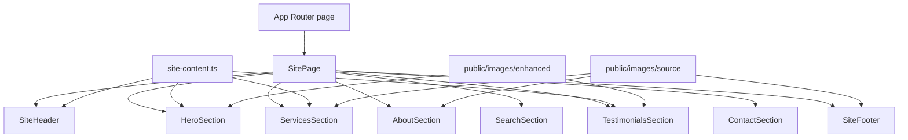
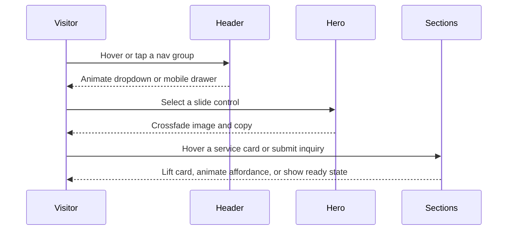

# TRAMCO Native Next.js Modernization

A clean, responsive homepage modernization for Texas Realty and Management Company. The implementation keeps the original TRAMCO visual identity and content structure while replacing the legacy WordPress runtime with a native Next.js application.

## What is included

- Native Next.js 16 App Router with a `src/` project layout
- Original TRAMCO logo, service images, background, and footer assets stored locally
- Modern hero photography and four distinct representative testimonial portraits in `public/images/enhanced`
- Responsive navigation with Framer Motion dropdowns and a mobile menu
- Motion-enabled hero carousel with autoplay, pagination, and directional controls
- Interactive service cards, testimonial carousel, and contact form state
- Responsive layouts for phones, tablets, and desktop screens
- No iframe and no dependency on the WordPress frontend at runtime
- Metadata, Open Graph defaults, local favicon, and semantic landmarks

The testimonial portraits are representative visual placeholders created for the modernization. Replace them with client-approved photography before a production launch.

## Architecture



## Interaction model



## Scripts

| Script | Purpose |
| --- | --- |
| `npm run dev` | Start the local development server |
| `npm run build` | Create a production build |
| `npm run start` | Serve the production build |
| `npm run lint` | Run ESLint across the project |
| `npm run typecheck` | Run TypeScript without emitting files |

## Local development

```bash
npm install
npm run dev
```

Open `http://localhost:3000` to review the homepage.

## Deployment

The project is configured for Vercel deployment and can be published with:

```bash
npx vercel --prod
```

The repository is designed so all visible page assets are served from the project itself. The external HAR property search and regulatory PDF links remain intentional outbound links.
